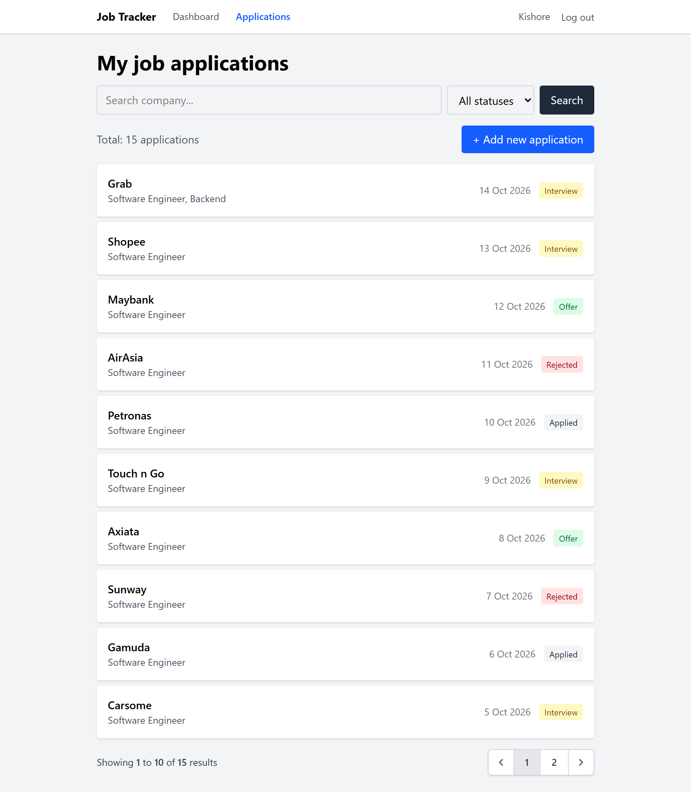
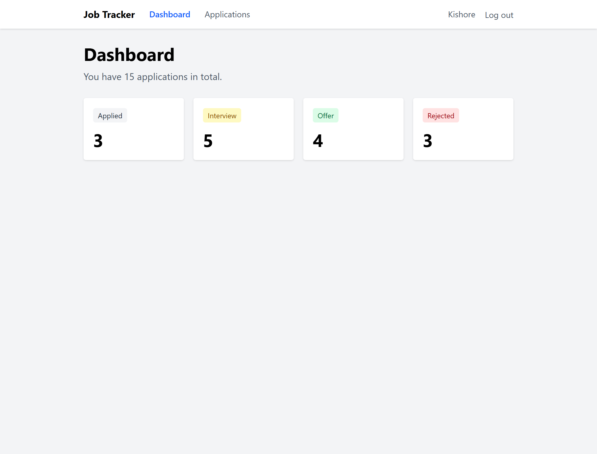
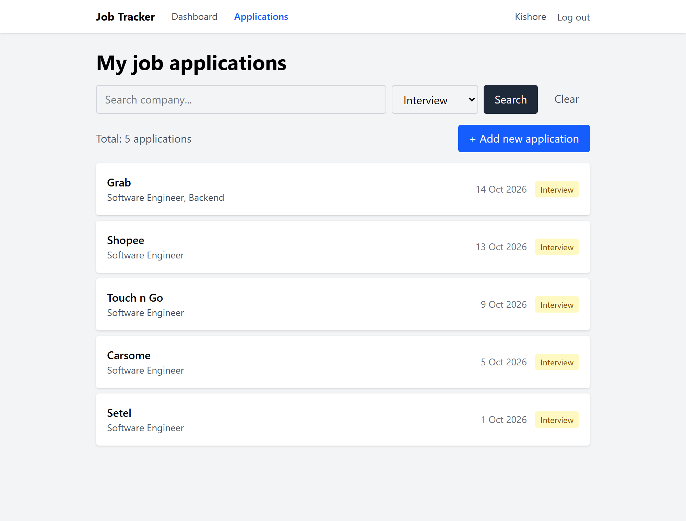
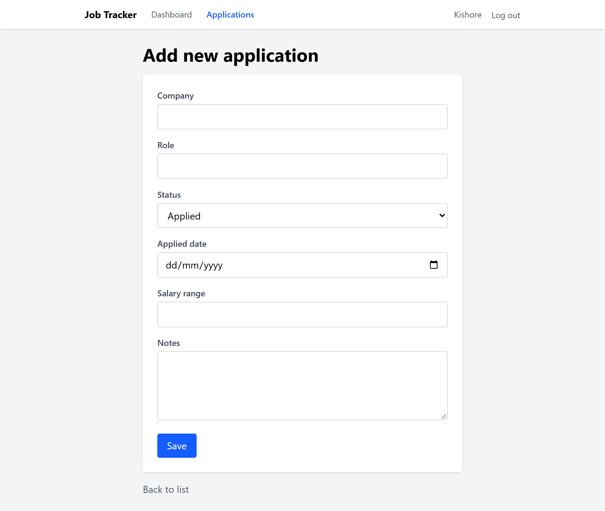
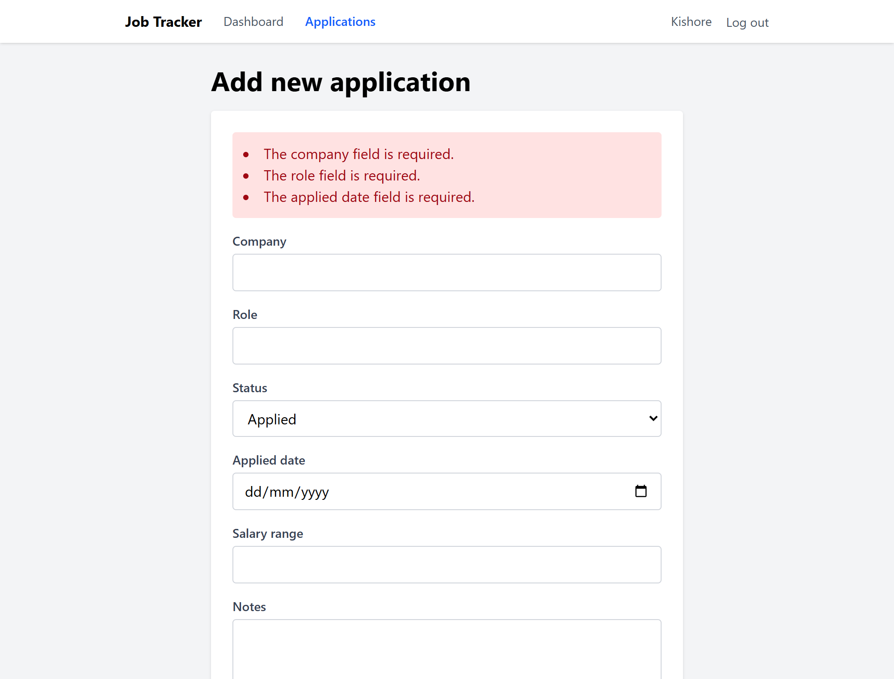
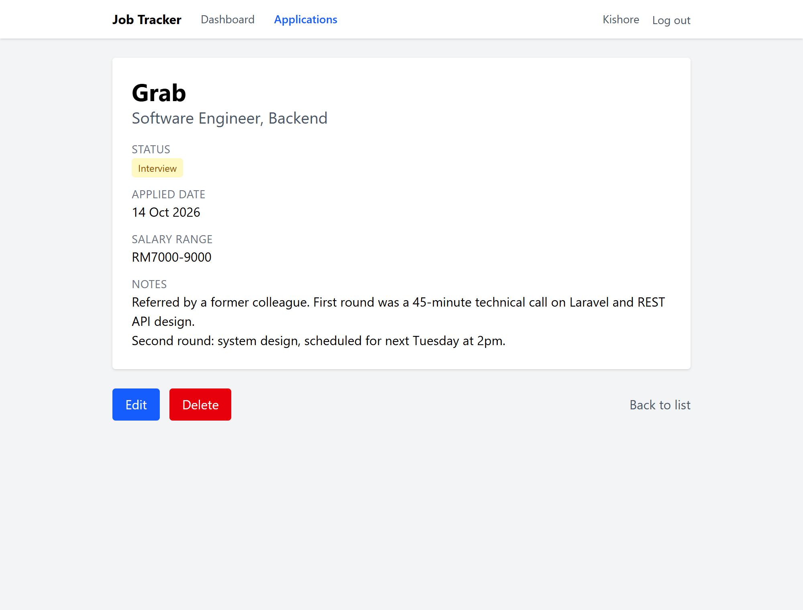
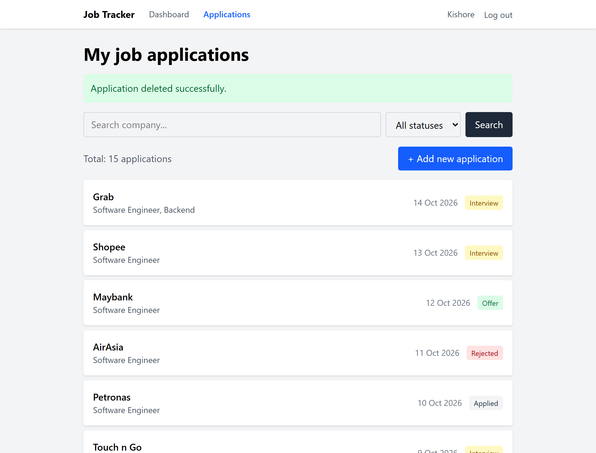
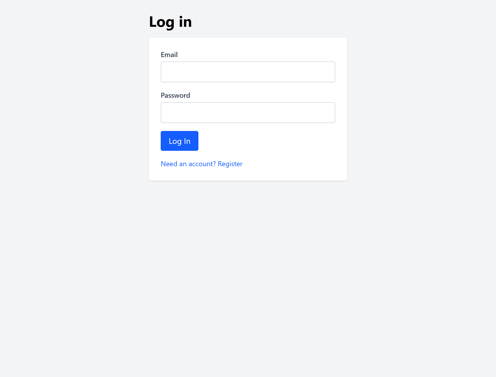

# Job Tracker

[](https://github.com/kishorekannan25/job-tracker/actions/workflows/tests.yml)

A web app for tracking job applications: which companies you applied to, what stage each
application is at, and what you need to follow up on. Each user signs in and sees only their
own applications. The same data is also available through a token-authenticated REST API.

Built with Laravel 13, Tailwind CSS and MySQL.



## Features

- **User accounts**: register, log in, log out. Each user's applications are private to them.
- **Authorization**: a policy blocks users from viewing, editing or deleting records they
  don't own, including by typing the URL directly. The web app and the API share it.
- **Full CRUD**: add, view, edit and delete job applications
- **Dashboard**: a count of applications per status. Each card links to the filtered list.
- **Status tracking**: applied / interview / offer / rejected, with colour-coded badges. The
  statuses are defined once, in a PHP enum.
- **Search and filter**: search by company, filter by status, or combine both. Filters
  survive pagination.
- **Sorting and pagination**: newest application first, 10 per page
- **Server-side validation**: inline error messages, with the user's input kept on failure
- **Flash messages**: confirmation after every create, update and delete
- **REST API**: log in for a token, then list, view, create, update and delete applications
  as JSON (see [API](#api) below)

Each application records the company, role, status, date applied, salary range and free-text notes.

## Screenshots

| Dashboard | Search and filter |
| --- | --- |
|  |  |
| **Adding an application** | **Validation errors** |
|  |  |
| **Application detail** | **Confirmation after deleting** |
|  |  |
| **Logging in** | |
|  | |

## API

All endpoints are under `/api` and return JSON. Send `Accept: application/json` with every
request.

### Authentication

The API uses [Laravel Sanctum](https://laravel.com/docs/sanctum) personal access tokens. Log
in with your email and password to get a token:

```bash
curl -H "Accept: application/json" \
     -d "email=you@example.com&password=your-password" \
     http://localhost:8000/api/login
```

```json
{ "token": "1|aB9xKq..." }
```

Then send the token in the `Authorization` header of every other request:

```bash
curl -H "Accept: application/json" \
     -H "Authorization: Bearer 1|aB9xKq..." \
     http://localhost:8000/api/applications
```

### Endpoints

| Method | URL | What it does | Success |
| --- | --- | --- | --- |
| `POST` | `/api/login` | Exchange email and password for a token | `200` |
| `POST` | `/api/logout` | Revoke the token used for this request | `204` |
| `GET` | `/api/user` | The user the token belongs to | `200` |
| `GET` | `/api/applications` | Your applications, newest first, 10 per page | `200` |
| `POST` | `/api/applications` | Create an application | `201` |
| `GET` | `/api/applications/{id}` | One application | `200` |
| `PUT` | `/api/applications/{id}` | Update an application (send all fields) | `200` |
| `DELETE` | `/api/applications/{id}` | Delete an application | `204` |

`POST` and `PUT` take the same fields as the web form: `company`, `role`, `status`
(`applied`, `interview`, `offer` or `rejected`), `applied_date` (`YYYY-MM-DD`), and the optional
`salary_range` and `notes`.

An application looks like this:

```json
{
  "data": {
    "id": 14,
    "company": "Grab",
    "role": "Software Engineer, Backend",
    "status": "interview",
    "applied_date": "2026-10-14",
    "salary_range": "RM7000-9000",
    "notes": "Referred by a former colleague...",
    "created_at": "2026-10-14T07:13:39.000000Z"
  }
}
```

The list endpoint wraps the same objects in `data`, with pagination details in `links` and `meta`.

### Errors

| Status | When |
| --- | --- |
| `401` | No token, an invalid or revoked token, or wrong login details |
| `403` | The application belongs to another user |
| `404` | No application with that id |
| `422` | Validation failed. The response lists the errors per field. |

## Built with

- **Laravel 13** (PHP 8.3)
- **MySQL**
- **Laravel Sanctum** for API token authentication
- **Blade** templates with a shared layout, a form partial reused by create and edit, and a
  status badge component
- **PHP enum** for application statuses, used by validation, dropdowns, badges and the model cast
- **Form Request** holding the validation rules, shared by the web and API controllers
- **API Resource** controlling exactly which fields the API returns
- **Tailwind CSS 4**, compiled with Vite
- **PHPUnit** feature tests against an in-memory SQLite database
- **Laravel Pint** for code style, and **GitHub Actions** running Pint and the tests on every push

## Running it locally

**Requirements:** PHP 8.3+ (with `pdo_sqlite` enabled if you want to run the tests),
Composer, MySQL, Node.js

```bash
# 1. Clone and install PHP dependencies
git clone https://github.com/kishorekannan25/job-tracker.git
cd job-tracker
composer install

# 2. Set up the environment file
cp .env.example .env
php artisan key:generate

# 3. Create a MySQL database, then set these in .env:
#    DB_DATABASE=job_tracker
#    DB_USERNAME=root
#    DB_PASSWORD=
php artisan migrate

# 4. Install front-end dependencies and start the asset build
npm install
npm run dev

# 5. Serve the app (in a second terminal)
php artisan serve
```

Open http://localhost:8000, register an account, and you're in.

## Tests

```bash
php artisan test
```

14 feature tests cover:

- **Web app**: authentication, per-user data scoping, validation and the authorization policy
- **Dashboard**: guests are redirected, and counts include only the logged-in user's applications
- **API**: token login, wrong passwords, unauthenticated requests, per-user listing, creating
  an application, and blocking updates to another user's record

They run against an in-memory SQLite database, so development data is never touched.
[GitHub Actions](.github/workflows/tests.yml) runs them, along with a Pint style check, on
every push.

## Project structure

| Path | What's in it |
| --- | --- |
| `app/Enums/ApplicationStatus.php` | The four statuses, with their labels and badge colours |
| `app/Models/Application.php` | The Eloquent model, with its owner and its date and status casts |
| `app/Models/User.php` | `hasMany` applications, and Sanctum's `HasApiTokens` |
| `app/Http/Controllers/ApplicationController.php` | The web app's seven RESTful actions |
| `app/Http/Controllers/DashboardController.php` | Counts per status in one grouped query |
| `app/Http/Controllers/Auth/` | Registration and session (login/logout) controllers |
| `app/Http/Controllers/Api/` | API login/logout and the API's application actions |
| `app/Http/Requests/ApplicationRequest.php` | Validation rules shared by web and API |
| `app/Http/Resources/ApplicationResource.php` | The JSON shape of an application |
| `app/Policies/ApplicationPolicy.php` | Who may view, update and delete a record |
| `database/migrations/` | The `applications` table, its `user_id` foreign key, and Sanctum's tokens table |
| `resources/views/` | The layout, dashboard, application views, auth pages and status badge component |
| `routes/web.php` | Web routes: the resource behind `auth`, the auth pages behind `guest` |
| `routes/api.php` | API routes: login, then everything else behind `auth:sanctum` |
| `tests/Feature/` | Web, dashboard and API tests |
| `.github/workflows/tests.yml` | The CI pipeline |

## How this was built

I built this to learn Laravel properly, by typing it rather than cloning a tutorial.

I used an AI assistant as a tutor throughout: it explained each concept, told me what to
build next, reviewed what I'd written and pointed out my bugs. I typed the application code
myself, including the controllers, models, migrations, views, policy and tests, one step at a
time, running each change in the browser before moving on. The rest is Laravel's own
scaffolding, and this README was drafted with the assistant's help.

The point was to come out of it able to read and debug Laravel, not just to end up with
working code. A fair amount of the learning came from the mistakes: a misspelled `$request->`
property that silently dropped data, a validation rule with a stray space in it that made one
dropdown option impossible to save, a missing `@method('PUT')` that produced a 405 I had to
learn to read, and an empty `tests/Unit` folder that git never committed, which broke the
first CI run even though every test passed on my laptop.

Concepts I worked through along the way: routing and RESTful resource controllers, Eloquent
models and migrations, Blade layouts, partials and components, forms and CSRF, HTTP method
spoofing for PUT and DELETE, server-side validation and Form Requests, route model binding,
query building with `when()`, aggregate queries with `groupBy`, authentication, foreign keys
and relationships, authorization policies, PHP enums and model casts, pagination, REST APIs
with Sanctum tokens and API Resources, feature testing, styling with Tailwind, code formatting
with Pint, and continuous integration with GitHub Actions.

## Possible next steps

- Deploying it somewhere public
- Interview dates, with an "upcoming interviews" section on the dashboard
- Email reminders to follow up on applications with no reply
- File uploads for CVs and cover letters
- Email verification on registration
